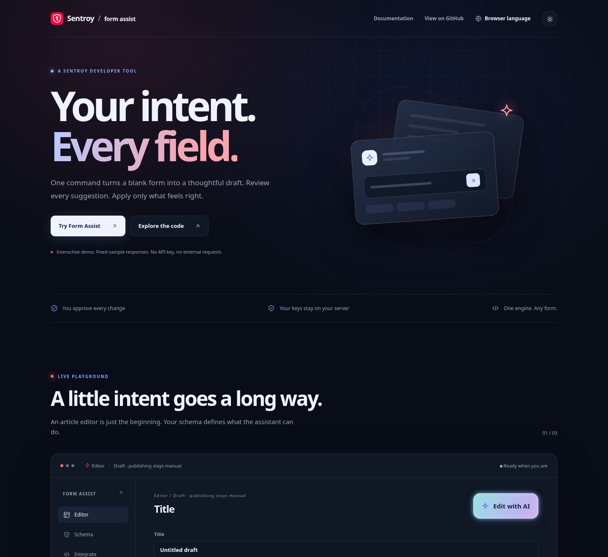
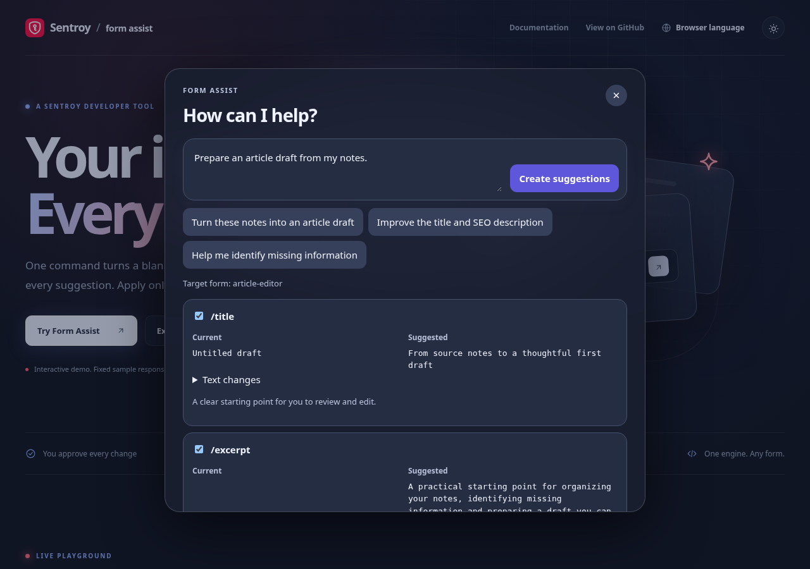
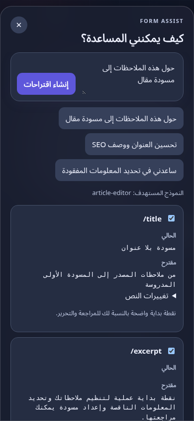

<div align="center">

<picture>
  <source media="(prefers-color-scheme: dark)" srcset="docs/assets/logo-dark.svg">
  
</picture>

<h1>Form Assist</h1>

### One intent. Every field. Your control.

Turn a request into **reviewable form suggestions** — with a glass Spotlight
interface or your own UI. Your schema sets the boundaries. Your user approves
every change. Your provider keys stay on your server.

<p>
  
  
  
  <a href="./LICENSE"></a>
</p>

<a href="https://sentroy-co.github.io/form-assist/"><b>Try the live demo</b></a> ·
<a href="./docs/QUICKSTART.md"><b>Quickstart</b></a> ·
<a href="./docs/API.md"><b>API & protocol</b></a> ·
<a href="./docs/I18N.md"><b>Languages</b></a> ·
<a href="./CONTRIBUTING.md"><b>Contribute</b></a>

</div>

---

## A form assistant that works inside your rules

A good suggestion should feel like a starting point, not a surprise. Form Assist
reads the fields you explicitly allow, returns a revision-bound change plan,
and lets users compare current and suggested values before applying selected
changes. It never saves, submits, publishes, pays or deletes on its own.

One engine works across different form schemas. Nothing in the core assumes an
article editor, a CMS or a particular provider. The article form in the demo is
one recipe, with a protected existing slug and publication state.

## What it looks like

A dark launch page with a cursor-responsive grid, a working editor, and the same
Spotlight interface you can embed. Light mode and right-to-left layouts are
included. These captures come from the running fixture demo.

<div align="center"></div>

<table>
<tr>
<td width="65%"><br><sub><b>Review first</b> — compare values and apply only selected fields.</sub></td>
<td width="35%"><br><sub><b>Every screen</b> — keyboard, reduced motion and mobile layouts.</sub></td>
</tr>
</table>

## Try the launch demo

**[Open the live demo on GitHub Pages](https://sentroy-co.github.io/form-assist/)** — no installation or API key required.

Try a sample prompt, review the proposed fields, apply selected suggestions, and undo your changes.
The hosted demo uses localized fixture responses rather than live AI requests.

To run it locally:

```sh
git clone https://github.com/Sentroy-Co/form-assist.git
cd form-assist
npm ci
npm run demo
```

Open http://localhost:5173. The demo detects `navigator.languages`, loads the
matching catalog, and translates the page, editor, prompts, comparison and
status text. Use the language selector to override it or return to browser
language. Switching languages preserves your edits and active proposal.

**Fixture mode:** responses are fixed, localized examples. No API key or model
request is involved. The launch screen labels this clearly. Provider credentials
belong in your authenticated host server when you integrate the SDK.

Build portable static files with `npm run build:demo`; output is
`artifacts/launch/`, with relative assets suitable for a repository subpath.
`npm run preview:demo` serves that production output locally.
The Pages workflow publishes this static demo automatically on pushes to `main`;
it can also be run manually from GitHub Actions.

## Two ways to integrate

| | Spotlight UI | Your own UI |
| --- | --- | --- |
| Interface | Explicitly registered Shadow DOM Web Components | Subscribe to the headless controller |
| Form state | Native, controlled React or React Hook Form binding | Any binding implementing read/write/subscribe |
| Approval | Field comparison and selected apply | Your own review and approval flow |
| CSS | Isolated glass/neon styles; dark/light themes | No prepared UI CSS required |
| Engine | The same schema validation and revision checks | The same schema validation and revision checks |

```ts
import { createAssistant, createHttpTransport } from '@sentroy-co/form-assist/browser';
import { registerFormAssist } from '@sentroy-co/form-assist/ui';

const assistant = createAssistant({
  binding,
  transport: createHttpTransport('/api/form-assist'),
  connectionId: 'editor',
  model: configuredModelId,
});

registerFormAssist(); // browser, after mount
const spotlight = document.querySelector('form-assist-spotlight');
spotlight.controller = assistant;
// No locale setting needed: the browser preference is used automatically.
// spotlight.locale = 'ja'; // optional explicit override
```

**The npm package is not published yet.** Build a local tarball with
`npm run pack:local`, then install
`artifacts/sentroy-co-form-assist-0.1.0.tgz` in your host project. The package
scope is provisional until ownership and a release license are settled.

## 54 languages, one localization system

The prepared UI and launch demo share complete UI and demo catalogs. Region and
script matching handles examples such as `fr-CA`, `pt-BR`, `zh-HK`, `zh-Hant` and
`zh-Hans`; unsupported preferences fall back to English. Arabic, Hebrew, Persian
and Urdu use right-to-left layout. Catalogs load on demand, so a visitor does not
have to download every translation up front.

See [the language guide](docs/I18N.md) for the exact list, overrides, SSR behavior
and contribution rules. Translations are machine-assisted; key coverage and
behavior are tested, while native-speaker editorial review remains open.

## What's inside

| Entry | Responsibility |
| --- | --- |
| `core` | JSON Schema 2020-12, safe change plans, revision checks, selected apply and undo |
| `server` | Host authentication hooks, registered forms, connection/model allowlists and limits |
| `providers` | Explicit server-side OpenAI, Anthropic, Gemini, Workers AI and gateway transports |
| `browser` | Snapshot binding, cancellation and the headless controller |
| `ui` / `i18n` | Glass Spotlight, credential editor, themes and lazy language catalogs |
| `native` / `react` / `react-hook-form` | Form-specific setters and validation bindings |
| `server/node` | Tenant-scoped AES-256-GCM encrypted local credential storage |
| CLI | The same engine through JSON/NDJSON; real Rust and C# process clients |

Core has no DOM or provider SDK dependency. Browser builds reject server imports.
Workers uses a separate portable graph; Node file storage stays Node-only.

## Develop and verify

```sh
npm ci
npm run build
npm run typecheck
npm test
npx playwright install chromium
npm run test:browser
npm run pack:local
npm run verify:package
```

[Validation details](docs/VALIDATION.md) record the actual checks and limits.
The first vertical includes native forms, React, React Hook Form, Next.js and
CLI clients. Other frameworks are marked planned in
[COMPATIBILITY.md](COMPATIBILITY.md). Live provider/model calls have not been
verified; transport tests are not advertised as live interoperability.
NDJSON exposes complete results and lifecycle events, not token streaming.

## Documentation

[Quickstart](docs/QUICKSTART.md) · [API](docs/API.md) ·
[Server & credentials](docs/SERVER.md) · [Providers](docs/PROVIDERS.md) ·
[Bindings](docs/BINDINGS.md) · [UI & themes](docs/UI.md) ·
[Languages](docs/I18N.md) · [CLI](docs/CLI.md) ·
[OpenAPI](docs/openapi.json) · [Architecture](docs/ADR-001.md)

## License and brand

The code is **UNLICENSED**, pending an explicit license decision. A public source
repository does not grant redistribution or commercial-use rights. The Sentroy
name and logos remain Sentroy trademarks. No npm release or paid hosted service
is created by this repository.

<div align="center"><sub>Built by the Sentroy team · <a href="https://sentroy.com">sentroy.com</a></sub></div>
